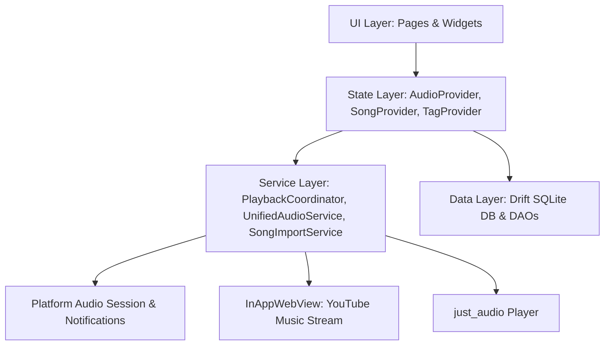

# MyMusic Codebase Architecture & Technical Documentation

## 1. Overview & Vision

**MyMusic** is a hybrid music player application built with Flutter. It blends high-performance offline local playback with tag-based library organization, custom metadata management, and an integrated YouTube Music web streaming experience that seamlessly shares audio focus and system media controls.



---

## 2. Tech Stack & Dependencies

* **Framework**: Flutter / Dart (SDK `^3.11.1`)
* **Audio Playback**: `just_audio` (`^0.10.6`), `just_audio_background` (`^0.0.1-beta.17`), `audio_session` (`^0.2.4`)
* **Local Persistence**: `drift` (`^2.34.2`), `sqlite3_flutter_libs` (`^0.6.0+eol`)
* **State Management**: `provider` (`^6.1.5+1`)
* **Streaming & Web**: `flutter_inappwebview` (`^6.1.5`)
* **Metadata & Storage**: `audio_metadata_reader` (`^1.6.0`), `file_picker` (`^8.0.0`), `path_provider` (`^2.1.6`), `permission_handler` (`^12.0.3`)
* **UI & Theming**: `hugeicons` (`^1.1.7`), `google_fonts` (`^8.2.0`)

---

## 3. Layered Architectural Breakdown

```
lib/
├── app.dart                    # App root, theming, navigation shell & offstage tabs
├── main.dart                   # Global initialization, audio bootstrap & providers
├── core/
│   ├── constants/              # Global constants & defaults
│   ├── theme/                  # AppColors, AppTheme, AppTypography, Glassmorphism
│   └── utils/                  # File utils, art extraction & formatting
├── data/
│   ├── database/               # Drift database, schema migrations
│   │   ├── daos/               # SongDao, TagDao, SongTagDao
│   │   └── tables/             # Songs, Tags, SongTags SQLite tables
│   └── models/                 # Pure Dart models (QueueState, Tag, Song)
├── providers/                  # ChangeNotifier view models (Audio, Song, Tag)
├── services/                   # Core audio engine, coordinator, importers, stream bridge
│   ├── ad_block/               # Ad filtering scripts for WebStream
│   ├── stream/                 # Web stream controller, JS bridge & state observer
│   ├── custom_art_service.dart # Custom cover art persistence
│   ├── directory_settings_service.dart # Music directory config
│   ├── permission_service.dart # Storage & notification permissions
│   ├── playback_coordinator.dart       # Mutex coordinator for local vs stream audio
│   ├── song_import_service.dart        # Background file scanner & ID3 extractor
│   ├── system_media_session_adapter.dart # Android MediaSession integration
│   └── unified_audio_service.dart      # Singleton owner of AudioPlayer instance
├── widgets/                    # Reusable UI components (MiniPlayer, VinylSpinner, etc.)
└── pages/                      # Feature screens
    ├── about/                  # About & credits
    ├── player/                 # Full screen player modal
    ├── search/                 # Library search
    ├── settings/               # Directories, storage & data clearing
    ├── stream/                 # YouTube Music InAppWebView page
    ├── tags/                   # Tag listing & Tag detail view
    └── vibe/                   # Home dashboard (carousel, shelf, song list)
```

---

## 4. Deep Dive into Core Modules

### 4.1. App Entry & Bootstrapping (`lib/main.dart` & `lib/app.dart`)
* **`main.dart`**:
  * Initializes `JustAudioBackground` for system notification controls on Android.
  * Initializes the `UnifiedAudioService` singleton to ensure audio focus listeners and the underlying `AudioPlayer` are ready before state initialization.
  * Instantiates `AppDatabase`, `StreamSessionController`, `PlaybackCoordinator`, and `AudioProvider`.
  * Wraps the application with `MultiProvider` to inject dependencies across the widget tree.
* **`app.dart`**:
  * Configures dark aesthetic theming (`AppTheme.darkTheme`).
  * Manages global permission requests (Storage & Notifications).
  * **Persistent Tab Shell (`_AppShell`)**: Uses `Stack` with `Offstage` + `TickerMode` for the 3 main tabs (`Home`, `Stream`, `Library`). This is critical so that the YouTube Music `InAppWebView` remains alive in memory and continues playback uninterrupted when navigating between tabs.
  * Hosts the persistent [`MiniPlayer`](lib/widgets/mini_player.dart) anchored above the navigation bar.

---

### 4.2. Database & Data Models (`lib/data/`)
Persistence is powered by **Drift (SQLite)**.

* **Tables**:
  * **`Songs`** (`lib/data/database/tables/songs_table.dart`): Primary key `id` (UUID), `title`, `artist`, `album`, `duration` (ms), `file_path`, `file_size`, `added_at`, `last_played`, and `custom_art_path`.
  * **`Tags`** (`lib/data/database/tables/tags_table.dart`): Primary key `id`, `name`, `color` (int hex), `icon`, timestamps.
  * **`SongTags`** (`lib/data/database/tables/song_tags_table.dart`): Foreign keys linking `song_id` and `tag_id`.
* **DAOs**:
  * **`SongDao`**: Handles track queries (`getAllSongs`, `watchAllSongs`, `getRecentlyPlayed`), inserts, metadata updates, and custom art assignment.
  * **`SongTagDao`**: Manages song-to-tag relationships, tag-filtered song retrieval (`getSongsForTag`), and dynamic song count tallies (`getTagSongCounts`).
  * **`TagDao`**: Tag CRUD operations.
* **Migration Strategy**:
  * Version 2 added support for custom cover art (`custom_art_path`).

---

### 4.3. Audio Engine & Coordination Engine (`lib/services/`)

#### A. UnifiedAudioService (`unified_audio_service.dart`)
* Centralized singleton owning the `just_audio` `AudioPlayer`.
* Configures `AudioSession.instance` with `AudioSessionConfiguration.music()`.
* **Audio Focus Management**:
  * **Ducking**: Automatically reduces volume to `0.3` during transient audio focus loss (e.g. navigation instructions, notification chimes).
  * **Pause/Resume**: Pauses on full focus interruptions (e.g. phone calls) and resumes when focus returns.
  * **Headphone Unplug (`becomingNoisyEventStream`)**: Pauses immediately to prevent loud speaker output.

#### B. PlaybackCoordinator (`playback_coordinator.dart`)
* Implements a state-machine mutex that serializes all transitions between **offline local playback** and **web streaming**.
* Avoids race conditions and double-audio output by asynchronously locking operations via `_serialize`.
* Coordinates Android lock screen / notification actions via `SystemMediaSessionAdapter`.

#### C. SongImportService (`song_import_service.dart`)
* Recursively scans user-selected storage directories for supported audio formats (`.mp3`, `.m4a`, `.flac`, `.wav`, `.ogg`, `.aac`).
* Uses `audio_metadata_reader` to parse ID3 tags and extracts embedded artwork into the local app cache.

---

### 4.4. State Management Layer (`lib/providers/`)

* **`AudioProvider`**:
  * Exposes audio state: `isPlaying`, `position`, `duration`, `isLoading`, `currentSong`, and `queueState`.
  * Controls audio queues via `ConcatenatingAudioSource`.
  * Reconciles native shuffle and sequence changes via `_player.sequenceStateStream`.
  * Features track navigation (`playAllSongs`, `playFromTag`, `shuffleAllSongs`, `playNext`, `seek`, `toggleShuffle`, `toggleRepeat`).
  * Employs `ValueNotifier<Duration>` to optimize UI seekbar performance and prevent redundant tree rebuilds.
* **`SongProvider`**:
  * Exposes reactive song lists, directory management, scan statuses (`ScanStatus.scanning`, `ScanStatus.completed`), and file rename/delete actions.
* **`TagProvider`**:
  * Manages user tags, tag-color metadata, dynamic song count aggregation, and song-to-tag mappings.

---

### 4.5. UI & Presentation Layer (`lib/pages/` & `lib/widgets/`)

* **Design System**: Deep-space dark theme (`#0A0A0F` background, `#141420` surface, `#6C63FF` primary indigo, `#1BDB7A` playback green) with glassmorphic cards and dynamic gradient generators.
* **Vibe Page (`lib/pages/vibe/`)**: Home screen featuring interactive tag chips carousel, recently played horizontal tray, and sortable library list.
* **Full Player (`lib/pages/player/`)**: Immersive playback screen with animated vinyl record spinner, waveform visualizer bars, and retro slider.
* **Stream Page (`lib/pages/stream/`)**: Embedded YouTube Music web client with ad-blocking scripts, DOM listeners, and custom controls.
* **Tags Management (`lib/pages/tags/`)**: Tag overview grid and dedicated tag detail playlists.
